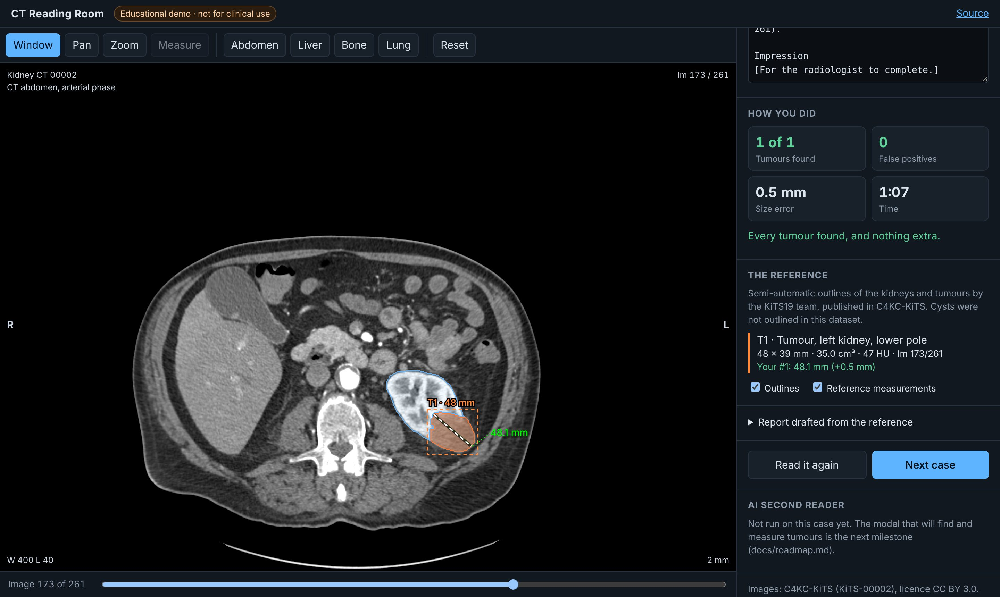

# CT Reading Room

Read real abdominal CT scans the way a radiologist does. Scroll through the
images, find every kidney tumour, measure it, and watch the report draft itself
from your measurements. Then hand in your read to see the radiologists'
outlines and how close you were.

**Try it: https://ct-reading-room.gordongill24.workers.dev**

An AI second reader that finds, measures and drafts the same report is being
built: the site, the pipeline and the training data are ready, and the model is
next to be trained. What the project is for and why it is built this way:
[docs/project.md](docs/project.md); the plan: [docs/roadmap.md](docs/roadmap.md).

> **Educational demo, not for clinical use.** Every scan here is a
> de-identified public research scan or a synthetic one. Nothing on this site
> may be used to diagnose or treat anyone. See [docs/safety.md](docs/safety.md).



## What it does

- **A real DICOM viewer in the browser**, built on [Cornerstone3D](https://www.cornerstonejs.org/)
  (the engine inside the OHIF viewer), laid out like a hospital PACS: axial,
  coronal and sagittal views with crosshair lines you drag to move through them,
  drag to scroll, right-drag for window/level (abdomen, liver, bone and lung
  presets), pan, zoom, a right-click menu and a calibrated length tool.
- **A simulator.** Measure each lesion's longest axial diameter and say whether it is
  a mass or a cyst. Hand in, and the app matches your measurements to the
  radiologists' outlines: tumours found, false positives, size error, time.
- **A report that writes itself from measurements.** Every measurement goes
  into a structured draft (organ, side, size, image number). The impression is
  left for the reader: the drafter states what was measured, never what it means.
- **An AI second reader, built to be honest** (the model is in training). An
  nnU-Net v2 model outlines kidneys and tumours. `ctrr ai` measures its outlines
  with the same code as the reference, refuses any patient the model trained
  on, and writes them as DICOM SEG for a PACS. On the site its read appears
  only after hand-in, scored by the same rules as yours. Its training data is
  built: all 210 C4KC-KiTS patients checked, 170 to train and 40 held out,
  every case the site shows among the 40.
- **A Python pipeline** that turns CT DICOM plus a DICOM SEG into cases: it
  checks the geometry, measures each lesion RECIST-style (long and short axis,
  volume, mean HU), works out side and kidney pole, and writes a small bundle
  the site loads.

## Run it

You need Node 22+, pnpm, Python 3.12+ and [uv](https://docs.astral.sh/uv/).
Full set-up for Windows, Mac, Linux or Codespaces is in
[docs/getting-started.md](docs/getting-started.md).

```bash
cd web
pnpm install
pnpm dev
```

Open http://localhost:5173. The synthetic tutorial case is in the repository,
so this works straight after cloning. To add real kidney-tumour scans:

```bash
cd pipeline
uv sync --extra dev
uv run ctrr fetch-kits --count 5
uv run ctrr build-kits
```

To build the AI's training data and add its read to cases (training itself
needs a GPU; [docs/training.md](docs/training.md) and
[docs/ai-plan.md](docs/ai-plan.md) have the steps):

```bash
cd pipeline
uv sync --extra dev --extra train
uv run ctrr fetch-kits --raw .data/train-raw --count 210 --max-slices 100000
uv run ctrr train-data --raw .data/train-raw --out .data/nnUNet_raw
# … train nnU-Net, then for each case:
uv run ctrr ai-input kits-00002
uv run ctrr ai kits-00002 --prediction kits-00002.nii.gz --model model.json
```

## How it fits together

```
Imaging Data Commons (public CT + SEG)              synthetic phantom
            │                                              │
            ▼                                              ▼
 pipeline/  ctrr fetch-kits ──► ctrr build-kits / ctrr phantom
            │                   reads DICOM, checks geometry, measures lesions
            │
            ├──► ctrr train-data ──► nnU-Net on a GPU ──► ctrr ai
            │    170 train · 40 held out                  measures its outlines
            ▼                                                   │
 web/public/cases/<id>/  case.json · ct/*.dcm · truth.json · labels.u8.gz · ai.json
            │
            ▼
 web/  React + Cornerstone3D reading room (static site)
            │
            ▼
 Cloudflare: a Worker serves the site; real scans come from R2
```

[docs/architecture.md](docs/architecture.md) explains each part and why it is
built that way. [docs/case-format.md](docs/case-format.md) is the contract
between the pipeline and the site.

## Checks

```bash
cd web && pnpm typecheck && pnpm test && pnpm build
cd pipeline && uv sync --extra dev --extra train && uv run pytest
```

CI runs the same on every push (`.github/workflows/ci.yml`). The `train` extra
brings SimpleITK; without it the NIfTI tests skip rather than run.

## Docs

| | |
|---|---|
| [project.md](docs/project.md) | What the project is for, what it will contain, and the decisions behind it |
| [roadmap.md](docs/roadmap.md) | What is done, and the plan to finish |
| [findings.md](docs/findings.md) | What the project has found so far: the field, the data, and from building it |
| [phase1.md](docs/phase1.md) | Phase 1 step by step: train, freeze, test once, model card, on the site |
| [training-diary.md](docs/training-diary.md) | The dated record of training the model: settings, numbers, problems, fixes |
| [getting-started.md](docs/getting-started.md) | Set up on any machine, first run, troubleshooting |
| [architecture.md](docs/architecture.md) | How the pipeline, viewer, scoring and report work |
| [case-format.md](docs/case-format.md) | The files a case is made of |
| [data.md](docs/data.md) | Datasets, licences, and adding more |
| [ai-plan.md](docs/ai-plan.md) | The AI second reader: data, splits, training, evaluation |
| [training.md](docs/training.md) | The training data, its checks, the fixed split, and training nnU-Net |
| [report-format.md](docs/report-format.md) | The drafted report's layout and the rules its checker enforces |
| [study-plan.md](docs/study-plan.md) | Draft protocol for the learner study (needs ethics approval) |
| [related-work.md](docs/related-work.md) | What others have built, and where this project fits |
| [deploying.md](docs/deploying.md) | Putting it online (Cloudflare Workers + R2) |
| [safety.md](docs/safety.md) | The rules this project keeps |
| [AGENTS.md](AGENTS.md) | Orientation for AI coding agents working in this repo |

## Credits

Kidney cases: C4KC-KiTS. Heller N, Sathianathen N, Kalapara A, et al. Data from
C4KC-KiTS. The Cancer Imaging Archive, 2019.
https://doi.org/10.7937/TCIA.2019.IX49E8NX. Licensed CC BY 3.0, served by the
[NCI Imaging Data Commons](https://portal.imaging.datacommons.cancer.gov/collections/c4kc_kits).

Code: MIT ([LICENSE](LICENSE)). The datasets keep their own licences.
